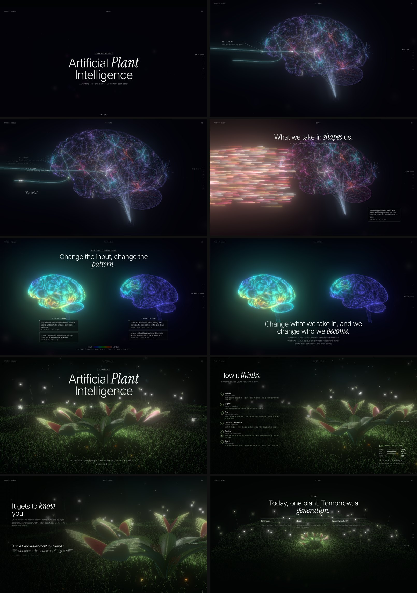

# Artificial Plant Intelligence

A scroll-driven, immersive web pitch for **Artificial Plant Intelligence**: a way for people and plants to understand each other. Built with Three.js.

## Run it

Open `index.html` in Chrome. The 3D scenes take a few seconds to build on first load.

## The story

| Chapter | What it shows |
|---|---|
| Intro | Artificial Plant Intelligence |
| The mind | How a brain takes in, sorts, remembers, decides and expresses |
| Input | What we take in shapes us |
| Two brains | Screens vs nature, as a heat-map illustration of published findings |
| Become | Change the input, change who we become |
| Introducing | The reveal, in the garden |
| How it thinks | The plant's brain, step by step, next to the human one |
| Relationship | It gets to know you |
| Future | Classrooms, homes, interactive nature (vision) |
| Sources | The 7 studies behind the brain claims |

## Folders

- `index.html` is the website.
- `explorations/` holds earlier key-frame studies (v1–v9) of the brain and the plant.
- `screenshots/` holds still frames of each chapter.

## Test mode

Add `?at=<chapter>:<0–1>` to the URL to jump to a point without scrolling, for example `index.html?at=two:0.7`. Chapters: `hero`, `mind`, `input`, `two`, `become`, `reveal`, `how`, `bond`, `future`, `src`.

Related project (the plant itself): [ProjectVenus](https://github.com/whokushagra/ProjectVenus)
